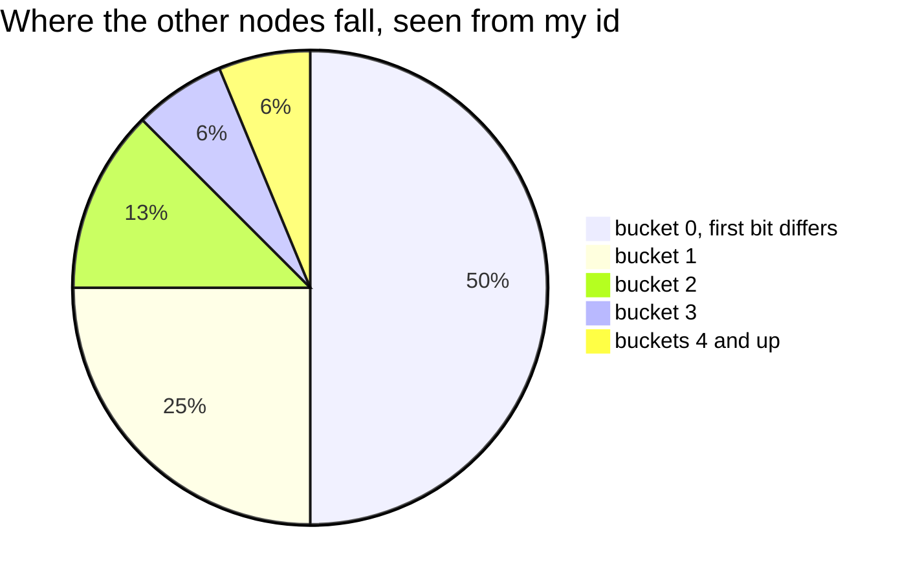
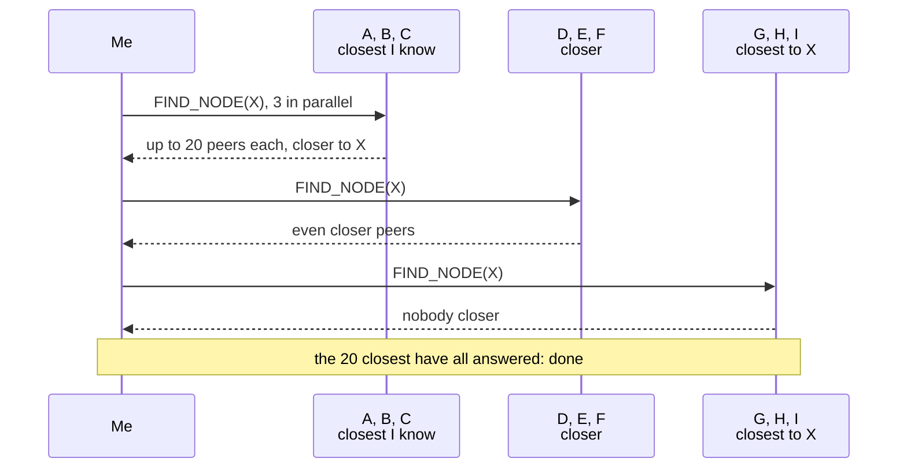
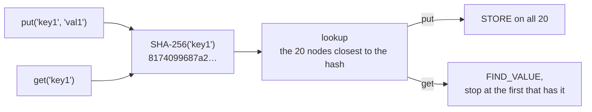
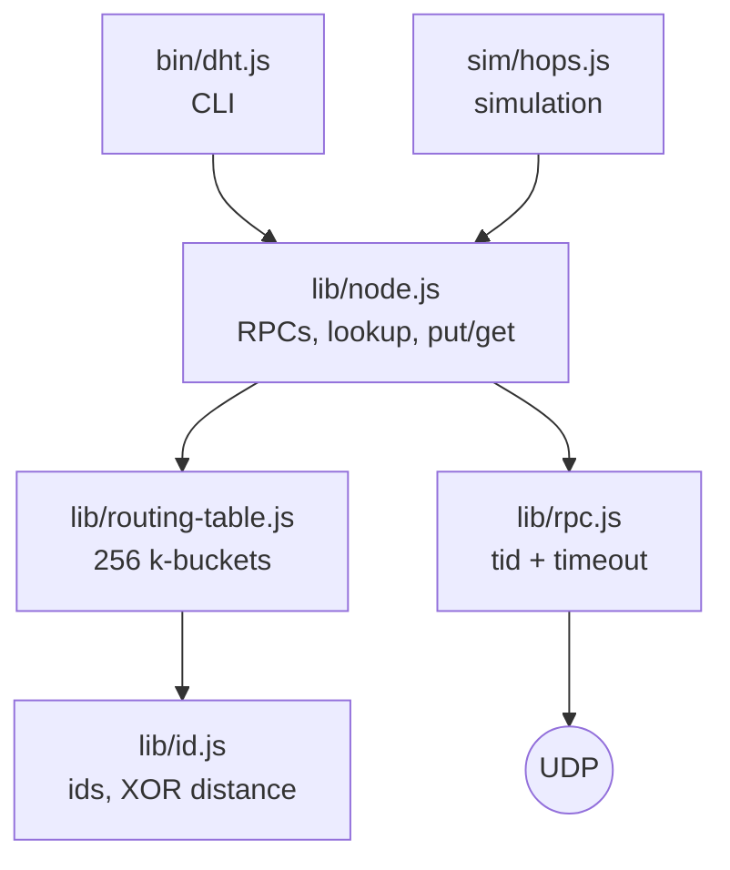

# dht

A Kademlia distributed hash table built on raw UDP in Node.js, no dependencies. Any
node can store a value and any other node can find it, with no server and no node
knowing the whole network. Each piece was added because the previous one left a
visible gap, so this is also a record of why Kademlia is shaped the way it is.

## How it works

```
id(node) = random 256 bits            id(key) = SHA-256(key)
d(a, b)  = a XOR b                    more leading bits in common = closer
bucket   = leading bits shared with my id     bucket i covers 1/2^(i+1) of the space
k = 20   peers per bucket, and replicas per value
α = 3    requests in parallel
```



Each bucket keeps at most 20 of its nodes: a few from the far half of the network,
almost everyone nearby.

A value lives on the **k nodes whose ids are closest to `hash(key)`**. Every operation
is built on one search:

**Lookup(X)**: find the k nodes closest to X in the whole network

1. start with the k peers I know closest to X
2. ask the α closest I haven't asked yet: _"who do you know closest to X?"_
3. merge the answers, keep the k closest, repeat
4. stop when the k closest have all answered: nobody I know can point any closer



| Operation       | How                                                                       |
| --------------- | ------------------------------------------------------------------------- |
| **join**        | ping one known node, then lookup my own id                                |
| **put**         | lookup `hash(key)`, then `STORE` on those k nodes                         |
| **get**         | same lookup with `FIND_VALUE`, stop at the first node that has it         |
| **full bucket** | ping the oldest peer: alive, it stays; dead, the newcomer takes its place |



| Cost                  | Grows as            | Measured, 1000 nodes           |
| --------------------- | ------------------- | ------------------------------ |
| peers each node keeps | ≤ k · log2 N        | 47, i.e. 4.7% of the network   |
| rounds for a get      | ~ log_k N           | 1.8                            |
| rounds for a lookup   | ~ k / α, plus a few | 8.4                            |
| losing a value        | all k replicas gone | still found with 15 of 20 dead |

Why XOR: it's symmetric, d(a, b) = d(b, a), so the nodes I ask learn about me through
the same messages. No separate discovery protocol.

---

## Run it

```bash
npm test                 # 46 tests
npm run coverage         # fails below 100% lines, branches and functions
node sim/hops.js 1000    # 1000 real UDP nodes in one process, measured

node bin/dht.js --port 5001                               # terminal 1
node bin/dht.js --port 5002 --bootstrap 127.0.0.1:5001    # terminal 2
```

CLI commands: `put <key> <value>`, `get <key>`, `table`, `storage`, `quit`.

---

## Code



Read it bottom-up: `id.js`, `routing-table.js`, `rpc.js`, then `node.js`.

---

## Wire format

One JSON object per UDP datagram. JSON instead of binary so packets can be read in a
log; the cost is size, not correctness.

| Field | Type          | Meaning                                     |
| ----- | ------------- | ------------------------------------------- |
| `t`   | 16-bit int    | transaction id, the response echoes it back |
| `y`   | `'q'` / `'r'` | request or response                         |
| `id`  | 64 hex chars  | sender's node id, present in every message  |
| `cmd` | string        | requests only: one of the four RPCs below   |

| RPC          | Request carries | Response carries                                |
| ------------ | --------------- | ----------------------------------------------- |
| `PING`       | nothing         | nothing                                         |
| `FIND_NODE`  | `target`        | `nodes`: the k closest peers the receiver knows |
| `FIND_VALUE` | `target`        | `value` if stored, otherwise `nodes`            |
| `STORE`      | `key`, `value`  | nothing                                         |

Every field coming from the network is validated before use. Anything malformed is
dropped silently: a DHT node receives garbage from the internet as a matter of course.

---

## How it evolved

Each step was added because the previous one left a visible gap.

| Step              | Added                                                     | What broke, or what it showed                                                                          |
| ----------------- | --------------------------------------------------------- | ------------------------------------------------------------------------------------------------------ |
| Ids and distance  | random 256-bit ids, SHA-256 keys, `d = a XOR b`           | 10 000 random ids: half in bucket 0, a quarter in bucket 1, almost none past 13 (log2 10 000 ≈ 13.3)   |
| Routing table     | 256 buckets of k = 20, oldest first                       | offered 10 000 peers, kept 197 (2%). `fill([])` shares one array; ids need `.equals()`, not `===`      |
| RPC over UDP      | transaction id + timeout                                  | sending to a dead port: no error, no reply, a process that never exits                                 |
| PING              | sender id in every message, address taken from the packet | **bug:** read `rinfo.host`, which doesn't exist. Worked by accident: `send` defaults to localhost      |
| FIND_NODE         | k closest peers, ids sent as hex                          | **bug:** a Buffer in JSON becomes `{"type":"Buffer"}`. Every answer was empty, with no error           |
| Lookup            | α = 3 in parallel, stop when the k closest answered       | on 200 nodes the table alone knew 0 to 7 of the real 20 closest; the lookup found 20 of 20             |
| Bootstrap         | ping one address, then lookup my own id                   | without the self-lookup: 15 of 20. **bug:** a `return` in a catch aborted the join on one dead address |
| put / get         | STORE on 20 replicas, FIND_VALUE stops at the first       | **bug:** `"key1".toString('hex')` is `"key1"`, so my own replica was stored under the wrong key        |
| Ping before evict | full bucket: keep the oldest if it answers                | **bug:** one of the two `table.add` calls skipped the check, so incoming requests bypassed it          |

Rules that came out of it: responses are accepted only from the address that was asked
(a 16-bit tid is easy to guess), and a peer someone else mentions is never added to the
table until it answers me directly.

---

## Results

`node sim/hops.js`, localhost, k = 20, every result checked against the true answer
computed from all nodes:

| Nodes | α   | Table size | Lookup rounds | Real 20 closest found | get rounds |
| ----- | --- | ---------- | ------------- | --------------------- | ---------- |
| 200   | 3   | 41 (20.6%) | 7.5           | 100%                  | 1.1        |
| 1000  | 3   | 47 (4.7%)  | 8.4           | 100%                  | 1.8        |
| 1000  | 1   | 44 (4.4%)  | 21.7          | 100%                  | 2.4        |

- **Tables grow with log N.** 5x more nodes added 6 peers per table.
- **A get takes 1 to 2 rounds.** Each answer brings up to 20 closer peers, so every
  round skips far more than one bit, and the get stops at the first replica.
- **A full lookup takes ~k/α rounds.** It has to hear from all 20 closest, 3 at a
  time, whatever the network size. With α = 1 that's 20+.
- **Values survive churn.** With 15 of the 20 replicas killed, the get still succeeds.

---

## Tests

46 tests, 100% of lines, branches and functions across `lib/`, `bin/` and `sim/`,
using only `node:test` and its built-in coverage. The CLI and the simulation are tested
as real processes. Network tests check results against ground truth rather than
expected outputs, and the suite passed 10 runs in a row.

---

## Known limitations

| Limitation                    | Why it matters                                                                                                                                         |
| ----------------------------- | ------------------------------------------------------------------------------------------------------------------------------------------------------ |
| One timeout removes a peer    | UDP drops packets on healthy links too. Real DHTs tolerate a few failures before evicting.                                                             |
| Buckets are never refreshed   | A bucket with no traffic keeps stale peers forever. Kademlia looks up a random id in each bucket idle for an hour.                                     |
| Stored values never expire    | No TTL and no republishing, so storage only grows and values aren't moved to new closest nodes as the network changes.                                 |
| Lookups wait for whole rounds | The slowest of the 3 requests holds up the next round. The paper keeps α requests in flight at all times.                                              |
| Anyone can overwrite any key  | `STORE` has no authentication. Mutable values need a signature (Ed25519) and a sequence number.                                                        |
| Ids are free to choose        | An attacker can pick ids next to a target key and surround it (Sybil). S/Kademlia binds ids to something costly; Holepunch's DHT binds them to the IP. |
| Localhost only                | No NAT traversal. Two nodes behind different routers can't reach each other directly.                                                                  |

---

## Background

- Maymounkov & Mazières, _Kademlia_ (2002): https://pdos.csail.mit.edu/~petar/papers/maymounkov-kademlia-lncs.pdf
- Starting point, a DHT in Go over gRPC: https://medium.com/@distroaryan/building-a-distributed-hash-table-dht-in-go-from-scratch-a-deep-dive-into-kademlia-6895c406dc9b
- Holepunch `dht-rpc`, the production version of these ideas: https://github.com/holepunchto/dht-rpc
- Node `dgram`: https://nodejs.org/api/dgram.html
